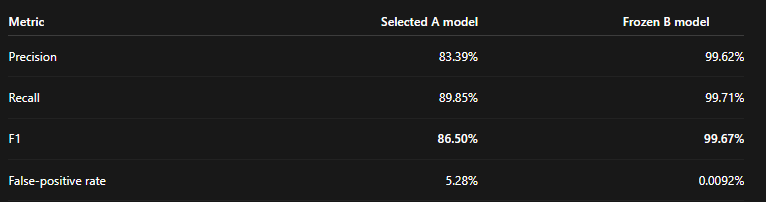

# Selected GNN results

Model: **New 2 native-clock/context A + original frozen B**. Evaluation completed
11 October 2026. These are GNN-only results on the saved evaluation population.

| Metric | Selected A | Frozen B |
|---|---:|---:|
| Precision | 83.3898% | 99.6194% |
| Recall | 89.8468% | 99.7143% |
| F1 | 86.4980% | 99.6668% |
| False-positive rate | 5.2804% | 0.009225% |
| Coverage | 100% | 96.0091% |
| True positives | 18,937 | 2,094 |
| False positives | 3,772 | 8 |
| False negatives | 2,140 | 6 |

The evaluation used 480 scenario captures and 100 standalone normal episodes,
11,600 graphs, and 92,511 primary active observations. Ambiguous beacon scenarios
were outside the primary metrics. B coverage is lower because unavailable/no
initiated-relationship observations are not scored as negatives.

The selected artifact uses `widened_native_mask30`, native source clock, 30%
feature masking, prior-context residual references and the saved 5% clean tail.
Its scaler, reference statistics, A/B thresholds and embedded frozen B weights
are included in `models/gnn/selected-a.pt`; the original B is also supplied for
integrity verification. `models/gnn/results.json` records the numeric results.

The overall saved acceptance target was not met: A exceeds the 5% FPR cap and
falls slightly below 90% recall. These scores do not establish live accuracy on
new traffic. Head C is untrained; compromise probabilities and attack-class
predictions are unavailable. Start integration in observation mode.

The reference fixture checks checkpoint loading and output reproduction only;
it does not reproduce these aggregate metrics. Full evaluation data is private.
